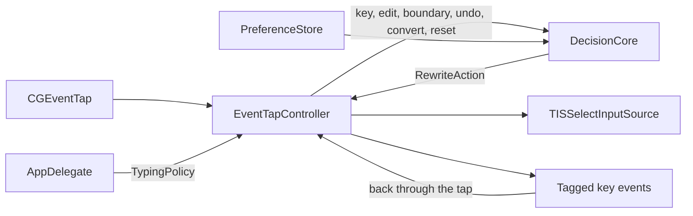

# macOS shell architecture

## Problem

MovaSwitch must observe physical keys, correct a finished word, and switch the input source without losing or reordering keys. It must work in native apps, browsers, Electron apps, and terminals, and it must never act while Secure Input is on. These constraints rule out editing through the Accessibility text API alone.

## Usage

The user types `ghbdsn` under the U.S. layout and presses Space. MovaSwitch selects Ukrainian-PC, deletes the six characters, replays the same six physical keys, and sends the Space. A lone tap of Right Option right after that restores `ghbdsn ` and U.S. Undoing the same word a second time adds it to the never-convert list. Short words that the engine cannot judge alone ride along: `ш фь іцшесрштп` typed under Ukrainian-PC becomes `i am switching ` in one rewrite, and one Right Option tap restores all of it. A lone Right Option tap with nothing to undo converts selected text, the current word, or the word just finished.

## Shape

`EventTapController` owns all typing state: the keys of the current word, the last finished word with its boundary key, up to three undecided short words the Rust core may still carry (it says how many after every call, and a pause of two seconds between words drops them), the lone-Right-Option detector, and the queue of keys held during a rewrite. Each automatic rewrite verifies the new input source, posts Backspaces, replays the original physical key codes without a Unicode payload, and re-sends the boundary key. Every posted event carries a marker. Physical keys that arrive while any marked event is still in flight are held, then recreated and released in order once the last marked event has come back through the tap. A 300 ms timeout releases them if an event is lost.

`AXSelectionConverter` reads and replaces selected text through `kAXSelectedTextAttribute`. It maps the characters through the live keyboard layouts, verifies the target input source, and never uses the pasteboard. If the focused app does not expose a settable selected-text attribute, it leaves the selection untouched and the word-buffer fallback still applies.

`DecisionCore` is the narrow protocol between the shell and a decision engine. `RustDecisionCore` is the primary core. It calls the engine's C ABI (`engine/include/mova_engine.h`) through a bridging header and links `libengine.a`. `BuiltinDecisionCore` is the Swift fallback with the same contract and a small vocabulary. It runs when the Rust engine cannot start, or when the `decisionCore` default is `builtin`.

`KeyboardLayoutTranslator` reads the installed U.S. and Ukrainian-PC layouts through `UCKeyTranslate`. The shell uses it to classify keys: a key belongs to a word when either layout renders it as a letter or an apostrophe. Space, Return, Tab and keys that are punctuation in both layouts end a word. Digits and every other key clear it.

`AppDelegate` owns the menu, the per-app modes, and permission. It tries to create the event tap every second, so the app goes live the moment Accessibility is granted, without a relaunch. While the grant is missing, each unlock shows the standard macOS prompt and opens the Accessibility pane. `PreferenceStore` persists the switches, per-app modes and the never-convert list. Nothing else typed is stored, and the app imports no network framework.

## Permission and signing

`build.sh` signs the bundle ad hoc and copies `install-app.sh` and `sign.sh` into `Contents/Resources`, so a release zip installs itself without a checkout. `install-app.sh` is the only install path: the root `install.sh`, `mac/install.sh` and the Homebrew command all call it. It runs `sign.sh` on the copy in `~/Applications`. `sign.sh` creates a self-signed code-signing identity once, in its own keychain under `~/Library/Application Support/MovaSwitch/signing`. The designated requirement names the bundle ID and that certificate, so an Accessibility grant survives every rebuild and update.

When the app has no Accessibility grant, `install-app.sh` opens the Accessibility pane so you can switch MovaSwitch on. The app writes `accessibility-granted` once the grant exists.

## Verification

| Script | What it proves |
| --- | --- |
| `test.sh` | Behaviour tests drive the real controller, both cores, and the installed layouts through a simulated desk, plus a key-by-key check that the engine's tables match macOS. No permission needed. |
| `check-live.sh` | Installed app, signature requirement, LaunchAgent, process, permission, watcher. |
| `e2e.sh` | Real events into a test window: rewrite, layout switch, Right Option undo, selected-text conversion, a correct word untouched, a secure field untouched. Needs the grant and an unlocked screen. |

## Alternatives considered

- Focused AX text replacement lost because terminals and some Electron text surfaces do not expose a writable value.
- Clipboard replacement lost because it changes user state and races with clipboard managers.
- Inserting Unicode text without key codes lost because apps that read key codes saw the wrong keys. Replaying key codes with the characters attached keeps both.
- A fixed delay before releasing held keys lost because it either reorders keys under load or adds latency. Counting marked events back through the tap does neither.

## Known gaps

- Conversion happens at the word boundary only. Mid-word conversion (spec C1) is not built.
- Browser address bars with inline completion (spec E3) are not handled specially.
- The build is Apple silicon only.
- First undo strikes live in memory only, so a restart forgets them.
